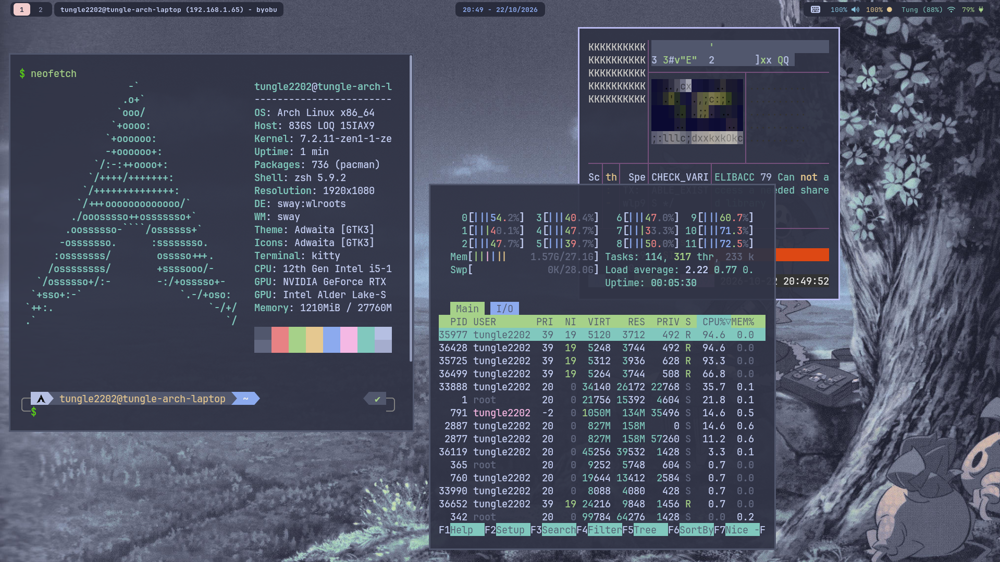
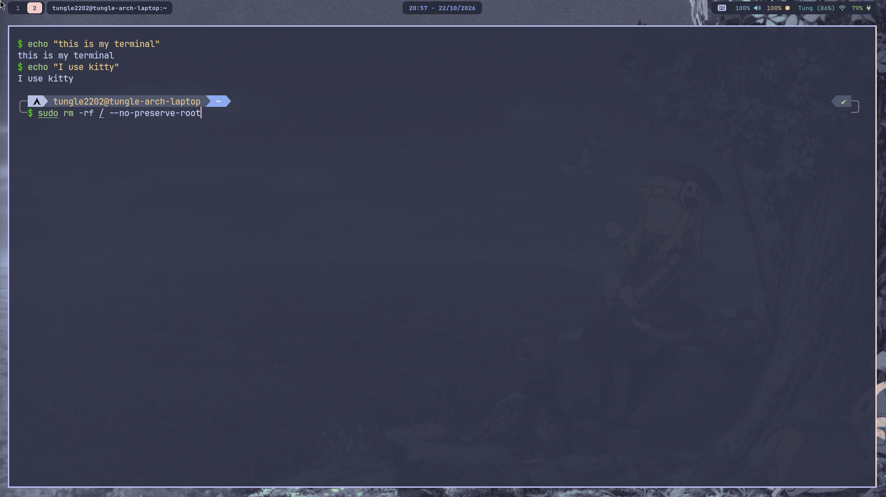
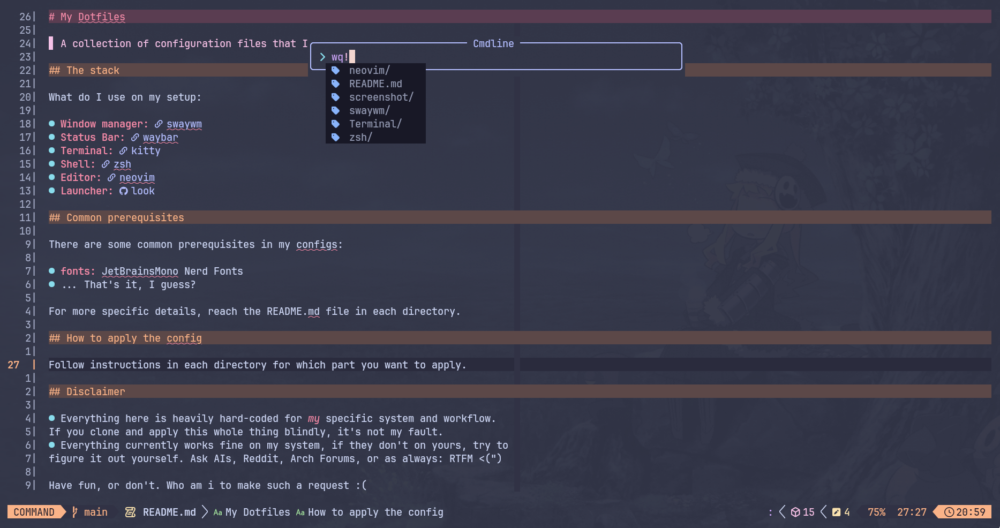

# My Dotfiles

> Wallpaper from [this repo](https://github.com/harilvfs/wallpapers)
> A collection of configuration files that I'm using on my linux system. It's pretty basic and lame, I'm not a 'ricer', please don't roast me.

## The stack

What do I use on my setup:

- **Window manager:** [swaywm](./swaywm/sway/)
- **Status Bar:** [waybar](./swaywm/waybar/)
- **Terminal:** [kitty](./Terminal/)
- **Shell:** [zsh](./zsh/)
- **Editor:** [neovim](./nvim/)
- **Launcher:** [look](https://github.com/kunkka19xx/look)

## Preview 

## Common prerequisites

There are some common prerequisites in my configs:

- **fonts:** JetBrainsMono Nerd Fonts
- ... That's it, I guess?

For more specific details, reach the README.md file in each directory.

## How to apply the config

Follow instructions in each directory for which part you want to apply.

## Disclaimer

- Everything here is heavily hard-coded for *my* specific system and workflow.
If you clone and apply this whole thing blindly, it's not my fault.
- Everything currently works fine on my system, if they don't on yours, try to
figure it out yourself. Ask AIs, Reddit, Arch Forums, or as always: RTFM <(")

Have fun, or don't. Who am i to make such a request :(
